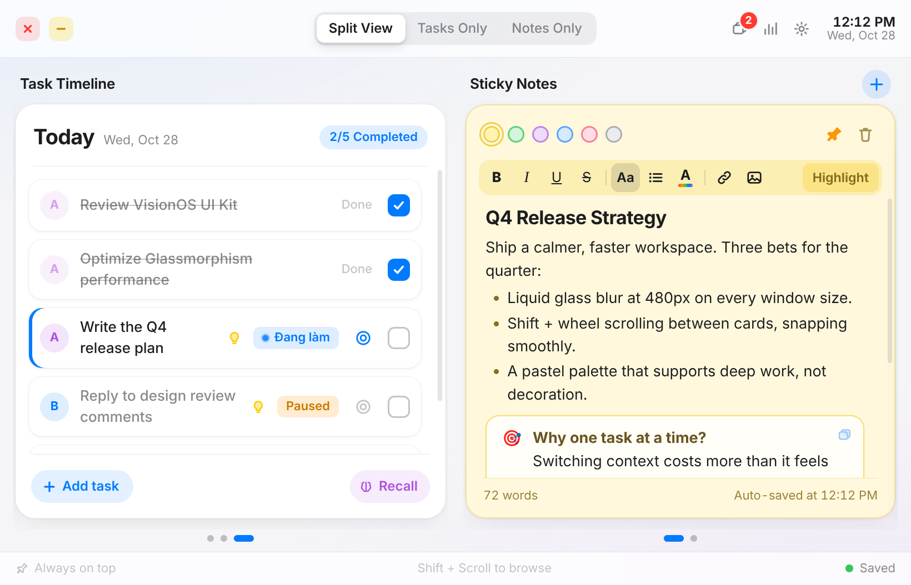
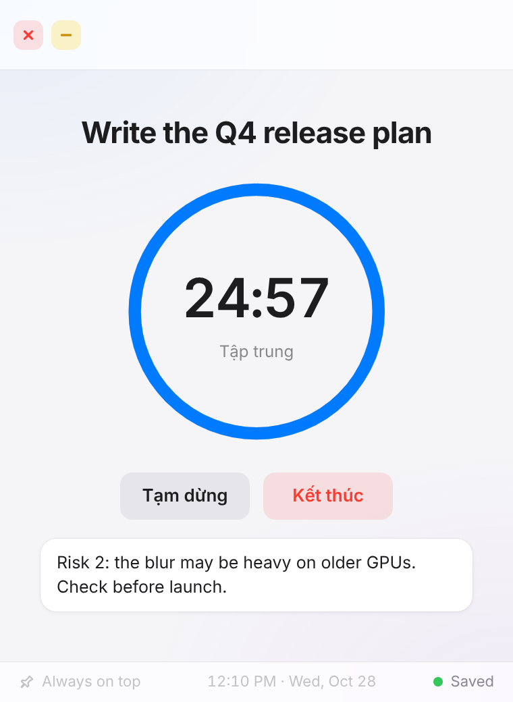
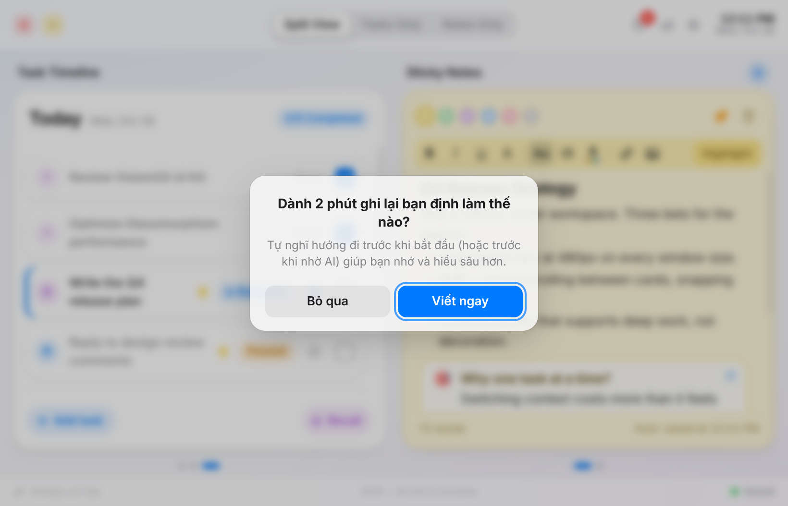
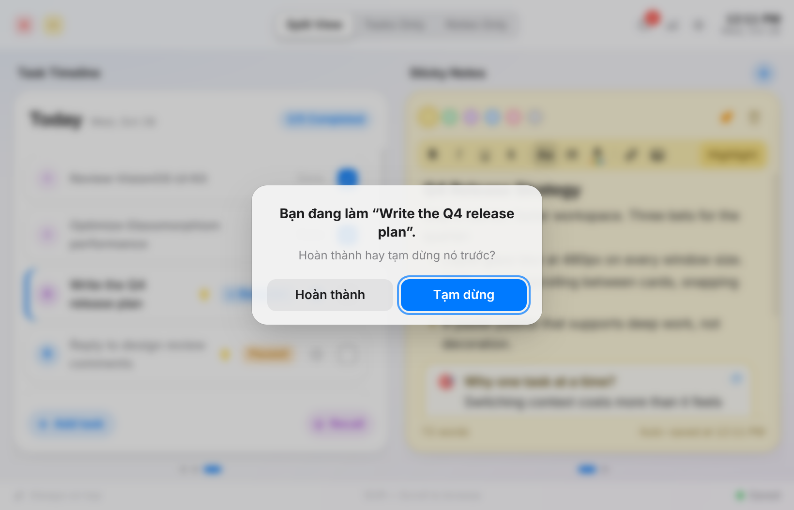
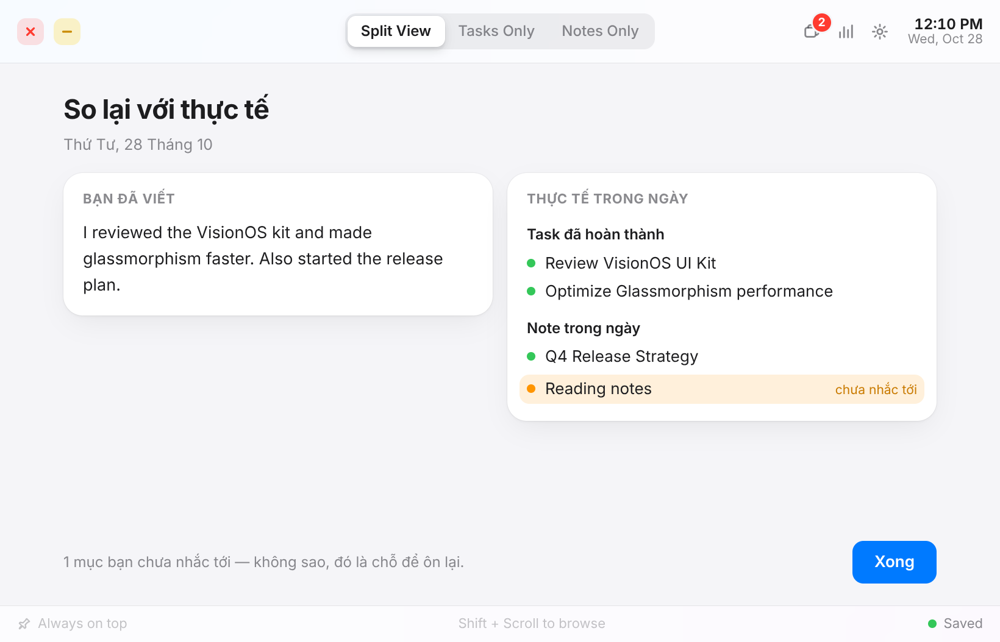
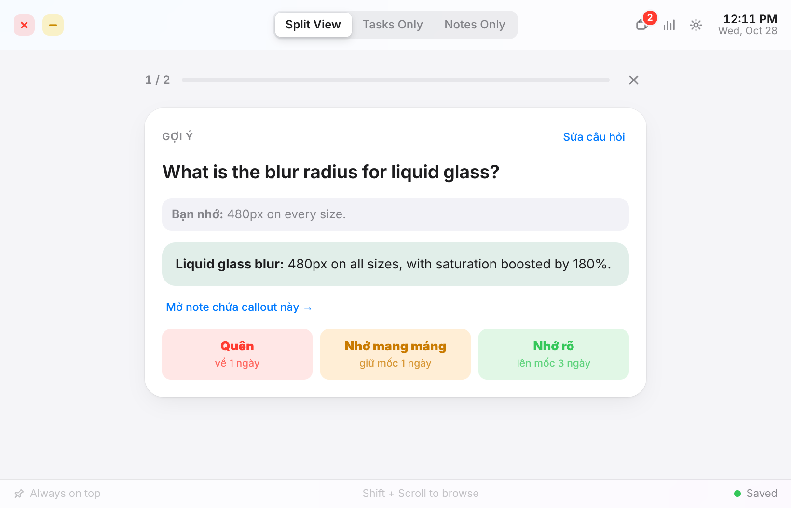
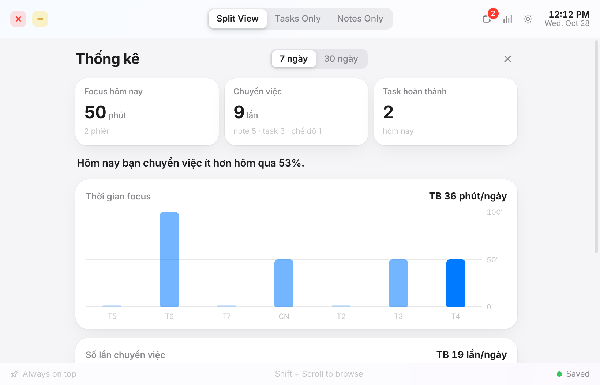
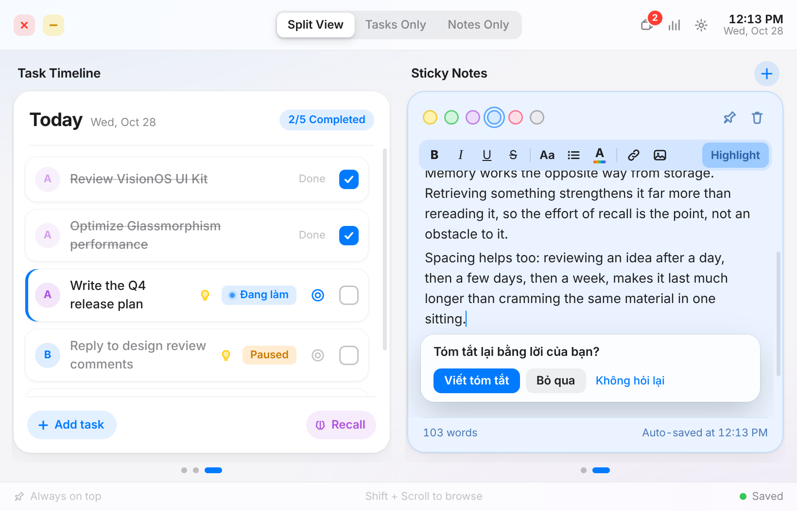
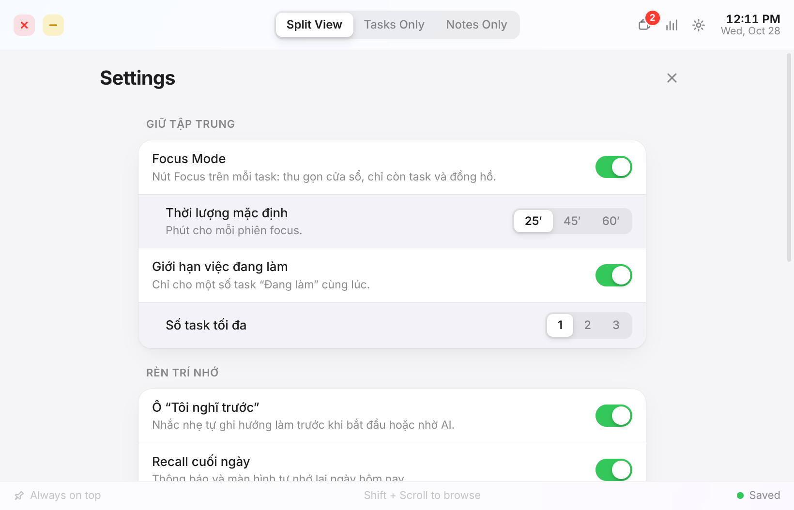

# Rotfree

**A floating task list and sticky notes app that helps you stay focused and remember what you learn.**

Rotfree lives in a small always-on-top window on your desktop. It looks like Apple's Sticky Notes, but it is built around one idea: your tools should help you think, not think for you. It nudges you to work on one thing at a time, write down your own ideas before reaching for AI, and recall things from memory instead of just storing them.

Built with Electron, Vite and Tiptap. Everything stays on your machine.

<p align="center">
<picture>
  <source media="(prefers-color-scheme: dark)" srcset="docs/screenshots/split-dark.png">
  
</picture>
</p>

## Why Rotfree exists

Prompting an AI is fast. That speed makes it easy to stop thinking: you paste a problem, accept the answer, and move on to the next tab without having understood much. Do that all day and your attention gets scattered, your own ideas get rarer, and you remember less of what you "learned". That is brain rot, and Rotfree is a small tool built to push back against it while you work with AI.

It does not block AI or lecture you. It adds a little friction in the places where friction helps:

- **Before you prompt, think.** Write your own approach first, so the AI becomes a second opinion rather than the first thought.
- **One thing at a time.** A work-in-progress limit and a distraction-free focus timer stop you from hopping between ten tasks and ten chats.
- **Digest, don't dump.** When you paste a long answer into a note, you are asked to summarise it in your own words.
- **Remember, don't just store.** End-of-day recall and spaced repetition make you retrieve what you learned instead of trusting that "it's saved somewhere".
- **See your habits.** Quiet stats show how often you switched context, without scores or guilt.

The nudges are gentle and every one of them can be turned off.

## Features

### The basics

- **Floating window.** Frameless, rounded, resizable, always on top (toggleable). Close sends it to the system tray. `Ctrl+Alt+N` shows or hides it from anywhere.
- **Three views.** Split View, Tasks Only and Notes Only. The window animates between them.
- **Task timeline.** One card per day, horizontal strip, `Shift + scroll` to move between days. Priorities (A/B/C), tags, drag to reorder, double-click to rename.
- **Sticky notes.** One card per note, five pastel colours, pinning, and a full rich-text editor: headings, lists, checklists, links, images (paste, drop, resize), inline code, markdown shortcuts and undo/redo.
- **Emoji picker** with `Ctrl+'`, and **Highlight** (`Ctrl+Shift+H`) to wrap any block in a callout.
- **Light and dark mode**, following your system.

### Anti brain-rot tools

Every feature below can be switched on or off in **Settings** (the gear in the title bar).

| Feature | What it does |
|---|---|
| **Focus Mode** | Pick a task and the window shrinks to just its name, a progress ring and a scratch note. Choose 25, 45, 60 minutes or your own. View shortcuts are locked, and leaving early takes one deliberate confirmation. When time is up, choose: done, 10 more minutes, or a 5-minute break. |
| **WIP limit** | Tasks get an "In progress" state. By default you can only have one at a time (1 to 3 in Settings). Starting another asks whether to finish or pause the current one. |
| **I think first** | Each task has a field for your own plan. Start or focus a task without writing one and you get a gentle prompt. Tasks with a plan show a small lightbulb. |
| **Daily Recall** | At a time you choose (default 21:00) Rotfree asks what you did and learned today, with your tasks and notes hidden. Only after you write do you see them side by side, with anything you forgot softly marked. |
| **Spaced repetition** | Every Highlight callout becomes a review card, scheduled after 1, 3, 7, 14 and 30 days. Recall it first, then reveal the answer and rate yourself. A badge in the title bar shows what is due. |
| **Switch stats** | Tracks how often you switch between notes, tasks and views, and how long you focus. Charts for 7 and 30 days in the style of Screen Time. No scores, no judgement. |
| **Paste nudge** | Paste a long passage (over 80 words by default) and Rotfree offers to fold it away and open an empty "My summary" callout, so you write it in your own words. |

## Screenshots

Each screenshot comes in light and dark mode (GitHub shows the one that matches your theme).

<table>
<tr>
<td align="center" valign="top"><b>Focus Mode</b><br>
<picture>
  <source media="(prefers-color-scheme: dark)" srcset="docs/screenshots/focus-dark.png">
  
</picture>
</td>
<td align="center" valign="top"><b>Think first</b><br>
<picture>
  <source media="(prefers-color-scheme: dark)" srcset="docs/screenshots/think-dark.png">
  
</picture>
</td>
</tr>
<tr>
<td align="center" valign="top"><b>One thing at a time</b><br>
<picture>
  <source media="(prefers-color-scheme: dark)" srcset="docs/screenshots/wip-dark.png">
  
</picture>
</td>
<td align="center" valign="top"><b>Daily Recall</b><br>
<picture>
  <source media="(prefers-color-scheme: dark)" srcset="docs/screenshots/recall-dark.png">
  
</picture>
</td>
</tr>
<tr>
<td align="center" valign="top"><b>Spaced repetition</b><br>
<picture>
  <source media="(prefers-color-scheme: dark)" srcset="docs/screenshots/review-dark.png">
  
</picture>
</td>
<td align="center" valign="top"><b>Stats</b><br>
<picture>
  <source media="(prefers-color-scheme: dark)" srcset="docs/screenshots/stats-dark.png">
  
</picture>
</td>
</tr>
<tr>
<td align="center" valign="top"><b>Paste nudge</b><br>
<picture>
  <source media="(prefers-color-scheme: dark)" srcset="docs/screenshots/paste-dark.png">
  
</picture>
</td>
<td align="center" valign="top"><b>Settings</b><br>
<picture>
  <source media="(prefers-color-scheme: dark)" srcset="docs/screenshots/settings-dark.png">
  
</picture>
</td>
</tr>
</table>

Regenerate them with `npm run screenshots` (see [Regenerating screenshots](#regenerating-screenshots)).

## Getting started

Requires **Node.js 20+**.

```bash
npm install
npm run dev      # development, reloads as you edit src/
npm start        # build and run like the real thing
```

If Electron reports a missing binary, run `node node_modules/electron/install.js`.

## Building installers

```bash
npm run dist      # Windows installer and portable .exe, output in release/
npm run dist:dir  # unpacked folder only, quick to try
```

Build on Windows when you can. Building the Windows targets from Linux or macOS needs Wine.

### Regenerating screenshots

`npm run screenshots` builds the app, loads a demo workspace (`scripts/screenshot-seed.mjs`) and captures each scene in `scripts/scenes/` in light and dark mode into `docs/screenshots/`. It runs real Electron windows, so run it on a machine with a display. Pass scene names to redo only some, for example `npm run screenshots -- stats paste`.

## Keyboard shortcuts

| Keys | Action |
|---|---|
| `Ctrl+Alt+N` | Show or hide Rotfree (global) |
| `Ctrl+1` / `2` / `3` | Split / Tasks only / Notes only |
| `Ctrl+N` | New note |
| `Shift` + scroll | Move between cards |
| `Ctrl+B` `I` `U` | Bold, italic, underline |
| `Ctrl+Shift+X` | Strikethrough |
| `Ctrl+E` | Inline code |
| `Ctrl+K` | Insert or edit link |
| `Ctrl+'` | Emoji picker |
| `Ctrl+Shift+H` | Highlight block as callout (toggle) |
| `Tab` / `Shift+Tab` | Indent / outdent |

Markdown shortcuts while typing: `# ` headings, `- ` bullets, `1. ` numbered list, `[] ` checklist, `---` divider.

## Your data

Rotfree stores everything locally in `%APPDATA%\Rotfree\` on Windows (the folder is named after the app's product name):

- `workspace.json`: tasks, notes, settings, recalls, review cards, stats
- `window.json`: window position, size per view, always-on-top
- `images\`: images inserted into notes

The tray menu has Always on Top, Launch at Login, Open Data Folder and Quit.

## Project layout

```
electron/     main process: window, tray, global shortcut, saving, focus-mode resizing
src/          renderer: UI, editor extensions, and the focus, recall, review and stats modules
scripts/      dev server launcher, emoji data generator, screenshot generator
docs/         generated screenshots
```

## License

Add a license of your choice before publishing.
